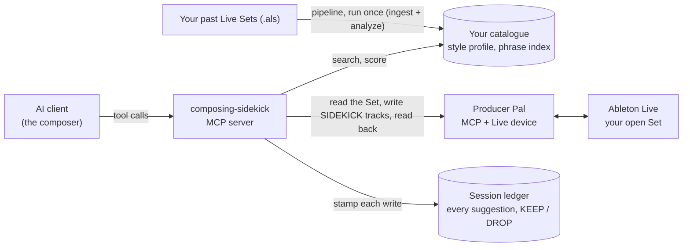
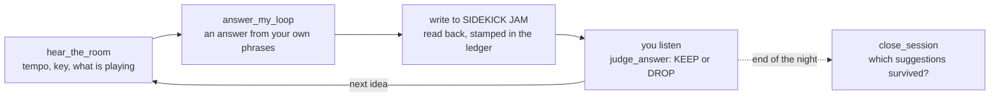

# composing-sidekick


composing-sidekick lets an AI assistant compose *with* you inside Ableton Live, using
your own past music as its main material. It reads the MIDI in your Live Sets, learns
your phrases and habits, and answers what you are playing with ideas built from them.
It writes those ideas only to tracks it owns, so you listen and keep or drop each one.

It is for producers who work in Ableton Live and want a partner that plays back their
own material rather than everyone's average. It is a personal tool by Ricardo Remédio,
used in the author's real composing sessions. The public repository ships **without**
his catalogue, notes, judgments or reference library; see
[What is personal](#what-is-personal-and-not-in-the-repo).

Learning from your catalogue is symbolic (MIDI notes, not audio). The optional listening
features do handle audio and send it to an outside model; see
[What leaves your machine](#what-leaves-your-machine).

## How it works

Your AI client (Claude Code, Codex, Cursor, Gemini CLI…) is the composer. It talks to two
[MCP](https://modelcontextprotocol.io) servers: this one, which holds your catalogue and
the composing tools, and [Producer Pal](https://producer-pal.org), which drives Ableton
Live.



A session runs as a loop. The score that matters is **survival**: how many of the
suggestions you judged are still in the Set at the end of the night.



`answer_my_loop` works in "gears", from plain recall up to composing: 1 returns your
nearest phrase as it is, 2 (the default) transposes and voice-leads it to fit your loop,
3 and 4 develop or extend it, and 5 and 6 let the AI compose under rules checked by the style
critics. KEEP adds the source phrase to your "gold" favourites; DROP stops it, and phrases
nearly the same, being served again (`clear_rejects` undoes that).

## What I decided vs what the agents wrote

- **I decided** what the tool is for and the rules it follows: my own material comes
  first and the generator is only a critic; automatic writes go only to tracks named
  `SIDEKICK …` and are read back; a night is scored by what survives, not by KEEP
  clicks. I also judge every musical result myself. <!-- Ricardo: confirm -->
- **AI coding agents wrote most of the code and the tests**, from my plans, and I
  reviewed their work. The plans, reviews and agent runbooks from the build are in
  [`docs/history/`](docs/history/README.md). <!-- Ricardo: confirm -->
- <!-- Ricardo: confirm — add one or two specifics in your own words, e.g. a design
  choice you made against an agent's suggestion, or a bug an agent introduced and how
  you caught it. -->

## Core tools

The server has 77 tools. Profiles (`SIDEKICK_MCP_PROFILE`, see below) limit which ones
the client sees, so it chooses among fewer: the default `compose` profile has 63, and a
normal session uses a handful. Every tool: [`config/claude_mcp.md`](config/claude_mcp.md).

| Tool | What it does |
|---|---|
| `hear_the_room` | Reads the open Set through Producer Pal: tempo, key, the MIDI of the clips playing. Also reports the judgment loop's state. |
| `find_phrases` | Finds real phrases from your catalogue, by role (lead, bass, drums…) or by fit to the room. |
| `answer_my_loop` | Answers your loop with your own material, through the gears above. `write=True` puts the answer on SIDEKICK JAM. |
| `develop_my_loop` | Takes one real phrase from your catalogue and applies one named development move. Never writes to Live. |
| `grow_my_loop` | Returns your loop untouched, each copy extended with a short continuation that grows out of it. |
| `write_composed_to_jam` | Writes notes the AI composed (gears 5 and 6) to SIDEKICK JAM, only if the style critics pass them. |
| `judge_answer` | Records your KEEP or DROP for a suggestion. |
| `close_session` | End of the night: checks which suggestions are still in the Set and scores the session. |
| `session_report` | Shows what the judgment ledger holds. |
| `score_phrase` | Scores a phrase against your style (0 to 1, with a verdict). |
| `export_midi` | Saves notes as a `.mid` file under `store/exports`. |
| `listen_to_takes` | Opt-in: sends audio takes from the Set to an outside listener model and keeps what it heard. |

## What it does

- **Learns from your catalogue.** `ingest/` reads every MIDI clip in your Live Sets
  (arrangement, session and take lanes, and it knows which clips are drums). `analyze/`
  turns them into a phrase index and statistics about your melodies, harmony, song
  structure, motifs and playing feel, under `store/`.
- **Composes from your material first.** `answer_my_loop`, `find_phrases`,
  `develop_my_loop`, `grow_my_loop`: call-and-response, variation and growth from the
  composer's own phrases. A seeded note generator exists, but only as a critic that
  scores ideas (`score_phrase`, `critique`, `validate_composed`).
- **Hears the room.** `hear_the_room` reads the open Set through Producer Pal (tempo,
  key, playing clips, what role each plays). Audio clips are reported by name only, as
  *named but unheard*. An opt-in **session ears** pass (`inventory_session_audio` →
  `listen_to_takes`) can send takes to an outside listener model.
- **Writes safely.** These tools write automatically only to tracks named
  `SIDEKICK JAM` and `SIDEKICK BOOTH`. Every write is read back and checked; anything
  else is a preview or needs your confirmation.
- **Closes the judgment loop.** Every JAM write is stamped in a session ledger; the
  composer judges KEEP/DROP; `close_session` checks the Set and scores *session
  survival* (suggestions still in the Set at the end of the night), the project's real
  measure of success.
- **Helps finish songs.** `whats_missing` reads a project and says what the song
  still lacks; `lay_the_song` maps one scene into a full-song layout with locators, in
  proportions measured from the catalogue; `three_endings` offers three ways to end
  from the loop's last bar; `bury_or_marry` deals one of your saved ideas to keep or
  retire; `one_hour_close` turns a project's top findings into short finishing tasks
  for one hour that ends in a bounce.
- **Uses references.** `analyze_audio_ref` files a local file or URL as a listening card
  plus a MIDI sketch (Basic Pitch); `find_audio_refs` / `apply_audio_ref` /
  `beat_from_ref` let a reference steer *which of the composer's own* phrases and drum
  clips are used.
- **Offline mix adviser** (separate, in the `debug` profile): measurements on exported
  stems, at most three small gain changes, a loudness-matched blind A/B, and its own
  ledger.

## Requirements

| Need | Notes |
|---|---|
| macOS | Developed and tested on macOS only (POSIX file locking, Darwin fsync path, Max for Live). |
| Python 3.12 | In a virtualenv at `.venv/` — the MCP config and every doc assume that path. |
| Ableton Live 12 | Captures were made on Live 12.4.6. The optional envelope bridge needs Live 12.2+ (`v8` object). |
| Producer Pal | The `.amxd` device in your Set **and** the npm client. `.mcp.json` pins `producer-pal@2.3.0`; the code speaks `2.2.0-rc1`, `2.3.0` and `2.4.0` from captured fixtures (`docs/PRODUCER_PAL_VERSIONS.md`). Keep the client pin equal to the device build in the Set. |
| Node.js / `npx` | Runs the Producer Pal client. |
| `ffmpeg` (optional) | Session-ears staging, audio-reference cuts; related tests skip without it. |
| `agy` CLI (optional) | External listener used by session ears, audio references and the mix witness (default model `gemini-3.8-flash-medium`, override with `SESSION_EARS_MODEL` / `AUDIO_REF_MODEL` / `MIX_WITNESS_MODEL`). Nothing listens without it; nothing breaks without it. |

## Install

```bash
git clone <this repo> composing-sidekick && cd composing-sidekick
python3.12 -m venv .venv
.venv/bin/pip install -r requirements.txt
# optional: basic-pitch pulls a TensorFlow stack on macOS that the code never imports (it runs on ONNX).
# Removing it saves space; afterwards `pip check` warns about basic-pitch, which is expected.
.venv/bin/pip uninstall -y tensorflow tensorflow-macos keras tensorboard
.venv/bin/python -m unittest discover -s tests -t .   # works on a clean clone (skips what needs your catalogue)
```

The server selftest (`mcp_server/server.py --selftest`) reads the generated style
profile, so run it after **Build your catalogue** below.

## Build your catalogue

The store is empty on a clean clone. Point the scanner at the folders that hold your
Live Sets, then run the pipeline **in this order** (each stage reads the previous one's
artifacts):

```bash
export SIDEKICK_CATALOG_ROOTS="$HOME/Music/Ableton:/path/to/other/projects"
python3 ingest/scan_catalog.py                # → store/catalog_manifest.json
python3 ingest/materialize.py                 # → store/projects/*.json (one parse of the drive)
.venv/bin/python analyze/harmony.py           # music21 → store/harmony.json
python3 analyze/structure.py                  # → store/structure.json
.venv/bin/python analyze/style_profile.py     # AFTER harmony + structure → style_profile.json + STYLE.md
python3 analyze/build_index.py                # → store/phrase_index.json
python3 analyze/motifs.py                     # AFTER build_index + style_profile
.venv/bin/python tools/build_directions.py    # direction axes (reads the profile)
# optional digs
.venv/bin/python tools/harvest_arrangement_dna.py && .venv/bin/python tools/build_phrase_curves.py
.venv/bin/python tools/build_groove_templates.py
```

`tools/rebuild_corpus.py --commit` runs scan → materialize → analyze with fail-closed
gates (every previously scanned root still mounted, project counts within 5 %) and
restores the previous artifacts if a stage fails. Pack and demo Sets you do not want
learned from go in `store/not_his_projects.json` (`{"blocked_projects": ["<project name>", …]}`,
matched case-insensitively); every analyzer honours it.

`store/NOTES.md` is **yours**: hand-written notes that survive every rebuild and are
read by the assistants and by `style_profile.py`.

## MCP setup

Add to `.mcp.json` at the repo root (Claude Code) or to your client's MCP config; use the
absolute path of your clone, MCP hosts do not expand `~`:

```json
{
  "mcpServers": {
    "style-sidekick": {
      "command": "<repo>/.venv/bin/python",
      "args": ["<repo>/mcp_server/server.py"],
      "env": { "SIDEKICK_MCP_PROFILE": "compose" }
    },
    "producer-pal": {
      "command": "npx",
      "args": ["-y", "producer-pal@2.3.0", "-f", "json", "-n", "midi-json"]
    }
  }
}
```

Install the Producer Pal device on a MIDI track in your Set
([producer-pal.org/installation](https://producer-pal.org/installation)), restart the
client, and start with a read-only `ppal-connect`: the sidekick checks the reported
`producerPalVersion` against its captured builds before any write. The Live endpoint is
`http://localhost:3350/mcp` (`PRODUCER_PAL_URL` overrides it).

### Ask before raw Producer Pal writes

The sidekick's own tools only write to `SIDEKICK …` tracks, but the same client also
has the full `producer-pal` server, which can create, change or delete anything in the
Set. In Claude Code, copy [`docs/examples/claude-settings.json`](docs/examples/claude-settings.json)
to `.claude/settings.json` (or merge its `permissions.ask` list into yours). It makes
Claude ask you before every Producer Pal create, update, duplicate or delete call, and
before `ppal-live-api`. Reads and playback stay unprompted.

### Profiles (`SIDEKICK_MCP_PROFILE`)

| Profile | Tools | Focus |
|---|---|---|
| `compose` (default) | 63 | Hearing, answering, developing, auditioning, judging, closing the session |
| `session` | 37 | Live Set interaction: hearing, take inventory/listen, clip reads, judgment, closeout |
| `reference` | 18 | Audio references: analyze, find, tag, clip, batch, reindex, apply |
| `debug` | 19 | Diagnostics, envelope probes, the offline Mix Adviser |
| `all` | 77 | Everything |

Tool reference, ears workflow, judgment ledger and audio-reference workflow:
[`config/claude_mcp.md`](config/claude_mcp.md). How a session runs:
[`docs/CURSOR_CHAT_PLAYBOOK.md`](docs/CURSOR_CHAT_PLAYBOOK.md).

## Tests

```bash
.venv/bin/python -m unittest discover -s tests -t .    # stdlib unittest; pytest is not installed
.venv/bin/python mcp_server/server.py --selftest        # offline; needs the built catalogue; must end green
```

The suite never contacts Live: `tests/_guard.py` fails any test that reaches the
Producer Pal port, and the selftest snapshots the store before running and refuses to
leave it changed. Tests that need catalogue-generated artifacts, `ffmpeg`, or a Producer
Pal capture that was never made **skip with a reason**; on a clean clone expect a few
hundred skips, zero failures.

Producer Pal behaviour is tested against reply **envelopes captured** from the real
device under `tests/fixtures/pp/` (read, mutate, legacy and version-specific runs per
build): the shapes, keys, orderings, warning and error texts are the device's. The
music inside them is synthetic: names are invented and the piece replay's notes are newly
drawn over the captured arrangement skeleton (`tests/fixtures/pp/README.md`). The fakes in `tests/pp_fakes.py` validate every call against that build's tool
schemas. Adding a build means capturing it on a disposable scratch Set first — see
`docs/PRODUCER_PAL_VERSIONS.md`.

## What leaves your machine

Learning from your catalogue is symbolic and local: the pipeline reads the MIDI inside
your `.als` files and writes its results under `store/`. Three optional features work
with audio, and each one sends audio to Google's Gemini model through the `agy` CLI:

- **Audio references** (`analyze_audio_ref`, `analyze_audio_refs_batch`). Given a
  YouTube URL, the tool downloads the audio with `yt-dlp`. The `describe` mode (on by
  default) then sends that audio, or a local file you name, to Gemini for a listening
  card. The `midi` (Basic Pitch) and `features` modes run locally. Only use recordings
  you have the right to use.
- **Session ears** (`listen_to_takes`, opt-in). Sends audio takes from your open Set,
  one at a time and cut to at most 45 seconds, to Gemini.
- **Mix witness** (`analyze_mix_pass(listener=True)`, off by default). Sends the
  exported master and group stems to Gemini.

Without `agy` installed, no audio is sent and the rest keeps working. Like any MCP
server, the sidekick's tool results (notes, phrases, style facts) also go to the LLM
client you connect, so your client's provider sees them.

## What is personal and not in the repo

Everything the pipeline derives from a catalogue is regenerated locally and gitignored:
`corpus/`, `store/projects/`, `store/phrase_index.json`, `style_profile.json`,
`harmony.json`, `structure.json`, `motifs.json`, `taste_model.json`, `automation.json`,
`phrase_curves.json`, `directions.json`, `store/audio_refs/`, `store/session_ears/`,
`store/exports/`, `tools/ideas/` experiment data, `.scratch/`.

Files that hold a composer's **words and judgments** (`store/NOTES.md`, `STYLE.md`,
`ratings.json`, `session_ledger.json`, `rituals.json`, `pieces.json`,
`piece_records.json`, `piece_decisions.json`, booth and audition votes) are created on
your machine the first time you use the matching tool. The public repository contains
none of the author's. The musical-knowledge skills under `.claude/skills/` ship as
templates for the same reason: the idiom, theory and listening notes they held were his.

None of the author's words, melodies, rhythms or measurements ship. Where the code
needs a value or a fixture that used to come from his catalogue, it now has a neutral
or synthetic stand-in (and, for calibration, an optional local override). The one
structural remainder is named below:

- **Producer Pal fixtures** (`tests/fixtures/pp/**`): captured reply envelopes with
  invented names and newly drawn notes; no note matches one in its corresponding
  original clip. The piece replay keeps the captured arrangement skeleton (clip
  positions, lengths, loop windows) and its per-bar harmonic outline; see
  `tests/fixtures/pp/README.md`.
- **Engine calibration** (`mcp_server/idiom_cells.py`): neutral defaults (common
  four-note cells, a moderate human-ish feel), tagged `evidence: "default"`. Put values
  measured on your own catalogue in the gitignored `store/calibration.json` (keys
  `cells`, `feel`) to override them. Role thresholds (`analyze/roles.py`) are plain
  conventional register and texture boundaries, not measured on anyone.
- **Rhythm library**: none ships. If you keep one, it lives in the gitignored
  `store/approved_rhythms.json` with its MIDI under `assets/approved_rhythms/`; the
  loader and `get_style()` tolerate its absence.
- **Audio-reference fixtures** (`tests/fixtures/audio_ref/`): generated by
  `make_synthetic.py` in that folder — seeded plateau energy curves and invented cards
  designed to trigger the detectors the tests assert, measured on no recording.

## Status (2026-10-14)

A working prototype, used in the author's real composing sessions.
The current product arc is **durable KEEP**: fewer features, more suggestions that
survive the session. Parked by design: SOMBRA, a full Max for Live pedalboard control
surface (its transport and OSC protocol exist, `docs/SOMBRA_DEVICE.md`), a `core`/`server` split,
stem separation, new note generators, automatic mixing. Ears-by-default is gated on a
pre-registered blind round (`docs/EARS_PROMOTION.md`).

## Licence

MIT — see [`LICENSE`](LICENSE). Copyright (c) 2026 Ricardo Remédio.

## Documentation map

| Doc | Purpose |
|---|---|
| [`docs/ARCHITECTURE.md`](docs/ARCHITECTURE.md) | Module map, data flow, store artifacts, transport contract, house rules |
| [`docs/CURSOR_CHAT_PLAYBOOK.md`](docs/CURSOR_CHAT_PLAYBOOK.md) | The session loop for any assistant: ears, JAM/BOOTH, gears, KEEP/DROP, references |
| [`docs/KNOWLEDGE_GUIDE.md`](docs/KNOWLEDGE_GUIDE.md) | What has authority, where knowledge lives, how to store a result once |
| [`config/claude_mcp.md`](config/claude_mcp.md) | MCP registration, every tool, ledger contract, audio-reference workflow, bridge install |
| [`docs/PRODUCER_PAL_VERSIONS.md`](docs/PRODUCER_PAL_VERSIONS.md) | Supported Producer Pal builds, what each capture proved, how to add a build |
| [`docs/SESSION_EARS.md`](docs/SESSION_EARS.md) | Listening to Set audio takes (opt-in) |
| [`docs/MIX_ADVISOR.md`](docs/MIX_ADVISOR.md) | Offline mix trials, CLI and invariants |
| [`docs/SOMBRA_DEVICE.md`](docs/SOMBRA_DEVICE.md) | OSC protocol and status of the Max device |
| [`docs/EARS_PROMOTION.md`](docs/EARS_PROMOTION.md) | Checklist before flipping ears on by default |
| [`docs/pieces/EXAMPLE.md`](docs/pieces/EXAMPLE.md) | Template for a piece's notes file |
| [`docs/research/README.md`](docs/research/README.md) | How to file written research for the assistants |
| [`docs/history/README.md`](docs/history/README.md) | Roadmap eras, reviews, plans and agent runbooks from the build |
| [`AGENTS.md`](AGENTS.md) · [`CLAUDE.md`](CLAUDE.md) · [`GEMINI.md`](GEMINI.md) | Entry points for assistants working in this repo |
