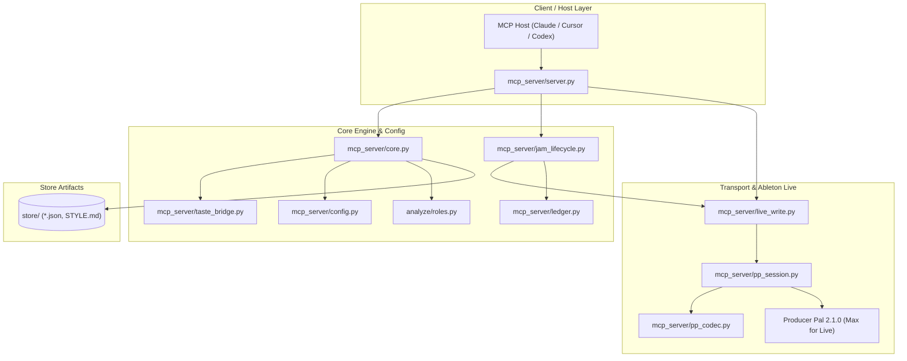

# Composing Sidekick — Architecture Map (Trunk 2026-08)

> **Historical note (2026-09-30):** written for Producer Pal 2.1; the client pin is now `producer-pal@2.3.0` and the transport speaks 2.2.0-rc1 and 2.3.0 (`docs/PRODUCER_PAL_VERSIONS.md`). Module map still valid.

An architectural map of the `composing-sidekick` trunk following the Producer Pal 2.1 migration, data integrity hardening, and role/config consolidation.

---

## 1. System Overview

`composing-sidekick` is an LLM composing bandmate for a composer that learns musical identity from their confirmed Ableton catalog (symbolic MIDI, not audio) and collaborates with him inside Live.

- **Primary Objective:** Drive **durable KEEP** — maximizing the proportion of suggestions that survive in the Live session over time (`session survival ÷ judged suggestions`), rather than raw generation volume.
- **Safety Policy:** Auto-writes are restricted to `SIDEKICK JAM` (answers/ideas) and `SIDEKICK BOOTH` (blind audition staging). All other tracks require preview/confirmation.
- **Fail-Closed Transport:** Communication with Ableton Live over Producer Pal MCP is operation-scoped, speaks structured JSON / `midi-json`, and verifies all writes with read-backs.

---

## 2. Module Map



### Module Responsibilities

| Module | Location | Primary Role & Key Functions |
|---|---|---|
| **Wire Codec** | [`mcp_server/pp_codec.py`](../../mcp_server/pp_codec.py) | Pure stdlib Producer Pal wire codec with zero external deps. Handles encoding/decoding `midi-json` short-key notation (`p`, `s`, `d`, `v`) via `notes_to_midi_json_payload()` and `midi_json_to_notes()`, tokenized bar\\|beat parsing, balanced JSON/object extraction, and clip classification tokens (`clip_type_token`, `clip_id_token`). The transport/export layer has one exception: `mido` (pinned as mido==1.3.3 in requirements.txt) is used solely for Standard MIDI File writing in `export_bridge.py`. |
| **Transport & Session** | [`mcp_server/pp_session.py`](../../mcp_server/pp_session.py) | Operation-scoped MCP transport adapter (`operation_session()`, `PPSession`). Executes tool calls (`call_tool()`), inspects `isError`, extracts version handshake (`handshake_from_connect()`), and enforces fail-closed verification helpers (`require_verified_note_count()`, `require_scene_count()`). |
| **Live Write Engine** | [`mcp_server/live_write.py`](../../mcp_server/live_write.py) | Orchestrates track/clip creation and live handoffs in Ableton Live via Producer Pal. Strictly confines auto-writes to `JAM_TRACK_NAME` (`"SIDEKICK JAM"`) and `BOOTH_TRACK_NAME` (`"SIDEKICK BOOTH"`), verifying every placement with read-backs. |
| **Central Config** | [`mcp_server/config.py`](../../mcp_server/config.py) | Consolidated server constants with documented provenance. Defines `PP_URL`, `BEATS_PER_BAR`, `SECTION_BUCKETS`, `_ROLE_ENERGY_THRESHOLD`, `_ROLE_LAYER_ORDER`, `_DROP_ENERGY`, `_DENSITY_PARAMS`, `_DRUM_DENSITY_TARGETS`, importing `ROLES`, `ROLE_THRESHOLDS`, `ROLE_SOURCE` from `analyze.roles`. |
| **Core Knowledge** | [`mcp_server/core.py`](../../mcp_server/core.py) | Style profile aggregation (`_aggregate()`), phrase retrieval (`find_phrases`), candidate generator algorithms, atomic storage helpers (via `core_shared`), and arrangement/compose tools. Facade-imports taste-layer names from `taste_bridge` but does not re-bind bridge-owned globals. |
| **Taste Bridge** | [`mcp_server/taste_bridge.py`](../../mcp_server/taste_bridge.py) | Sole owner of Bradley-Terry taste learning (`_retrain_taste()`), ratings/gold phrase management, phrase-pool override for selftest, and stale taste model detection (`_taste_model()`). Imported by `core.py` as a facade; `set_phrase_pool_for_test()` forwards writes here. |
| **JAM Lifecycle** | [`mcp_server/jam_lifecycle.py`](../../mcp_server/jam_lifecycle.py) | Suggestion lifecycle across all MCP write tools and SOMBRA pedal. Owns write stamping, refusal handling (`handle_no_fit_refusal()`), and immediate/terminal judgment routing. |
| **Session Ledger** | [`mcp_server/ledger.py`](../../mcp_server/ledger.py) | Durable KEEP recording in `store/session_ledger.json`. Pure stdlib, atomic writes, `fcntl` file locking. Stamps every JAM write and sweeps terminal states (`keep`, `drop`, `abandoned`, `unjudged`) via `close_session()`. |
| **Mix Contracts** | [`mcp_server/mix_contracts.py`](../../mcp_server/mix_contracts.py) / [`mix_trials.py`](../../mcp_server/mix_trials.py) | Offline Mix Adviser trial specifications and separate ledger (`store/mix_trial_ledger.json`). Keeps mix evidence independent from composing-session KEEP rates. |
| **Audio References** | [`tools/audio_ref.py`](../../tools/audio_ref.py) | External audio reference analysis. Generates listening briefs via `agy` (`DEFAULT_AGY_MODEL = "gemini-3.8-flash-medium"`), Basic Pitch MIDI transcription (`ref.mid`), and atomic index upserting. |
| **Mix Witness** | [`tools/mix_witness.py`](../../tools/mix_witness.py) | Offline mix listener witness evaluating stems/masters using `gemini-3.8-flash-medium` via `agy`. |
| **Role Classifier** | [`analyze/roles.py`](../../analyze/roles.py) | Versioned heuristic classifier (`ROLE_SOURCE = "rules_v1"`). Computes register and polyphony metrics against empirical catalog baselines (`ROLE_THRESHOLDS`) via `clip_role()` and `clip_role_report()`. |

---

## 3. Store Artifact Schema-Versioning Policy

All generated corpus artifacts in `store/` carry a top-level `"meta"` block documenting provenance and schema version.

### The `meta` Schema Block

```json
{
  "meta": {
    "schema_version": 1,
    "built_at": "2026-08-16T06:22:56Z",
    "code_rev": "ca35c68f1fe9aaae5f2cfacfc7406c47d3370190",
    "corpus": {
      "n_projects": 260
    }
  }
}
```

### Covered Artifacts
- `store/style_profile.json` (melodic grammar, groove grids, key/register profiles)
- `store/phrase_index.json` (indexed phrases across all confirmed projects)
- `store/harmony.json` (harmonic progression matrices and transition graphs)
- `store/structure.json` (section templates and arrangement energy curves)
- `store/motifs.json` (recurring melodic/rhythmic motif clusters)

### Validation & Mismatch Handling (`mcp_server/core.py`)
1. **Validation Entrypoint:** `_load_artifact(path, name)` calls `_validate_artifact_meta(path, data, name)`.
2. **Schema Mismatch:** If `meta.schema_version != _EXPECTED_ARTIFACT_SCHEMA_VERSION` (currently `1`), `_validate_artifact_meta()` raises a `ValueError` indicating the mismatch and detailing the required pipeline regeneration.
3. **Missing Meta Block:**
   - In legacy compatibility mode (`_ALLOW_LEGACY_ARTIFACTS_WITHOUT_META = True`), issues a `UserWarning` prompting an upgrade to schema version 1.
   - In strict mode (`_ALLOW_LEGACY_ARTIFACTS_WITHOUT_META = False`), raises a `ValueError`.
   - **Current mode: strict (since 2026-08-16).** The real store was rebuilt through the analyze pipeline; all five corpus artifacts carry `meta` blocks (`schema_version: 1`, `code_rev`, `corpus.n_projects`). The legacy-compat path exists only for migration and is not the runtime default anymore.
4. **Stale Model Detection:** In `_taste_model()` (`taste_bridge.py`), the stored `ratings_sha256` and `n_rounds` are checked against the current `store/ratings.json`. If a mismatch is detected, `model["stale"] = True`, disabling stale taste weighting (`_taste_weight() == 0.0`) until retrained. An **orphan model** (ratings.json missing entirely while the model records training provenance) is also flagged stale — an untraceable model never silently steers (review finding 5, 2026-08-16).

---

## 4. Atomic-Write House Pattern

To prevent partial writes or corrupted files during crashes or interruptions, all persistent state files follow the atomic-write house pattern (locator ownership in `live_write.py` and the materialized corpus in `ingest/materialize.py` included, as of the 2026-08-16 review round):

```python
def _save_json_atomic(path: str, data: dict, indent: int | None = 2) -> None:
    directory = os.path.dirname(os.path.abspath(path)) or "."
    os.makedirs(directory, exist_ok=True)
    fd, tmp_path = tempfile.mkstemp(
        prefix=f".{os.path.basename(path)}.",
        suffix=".tmp",
        dir=directory,
        text=True,
    )
    try:
        with os.fdopen(fd, "w", encoding="utf-8") as fh:
            if indent is not None:
                json.dump(data, fh, indent=indent)
            else:
                json.dump(data, fh)
            fh.write("\n")
        os.replace(tmp_path, path)
    except Exception:
        try:
            os.unlink(tmp_path)
        except FileNotFoundError:
            pass
        raise
```

### Invariants:
1. **Sibling Temp File:** `tempfile.mkstemp()` creates the temporary file in the *same* directory as the target file to guarantee atomic filesystem rename across partitions via `os.replace()`.
2. **Cleanup on Error:** `try...except` unlinks the temporary file if serialization or file writing fails.
3. **Usage:** Applied uniformly across `mcp_server/core.py`, `analyze/*.py`, `mcp_server/ledger.py`, `mcp_server/mix_trials.py`, `tools/audio_ref.py`, and `tools/ingest_journal.py`.

---

## 5. Fail-Closed Producer Pal Verification Contract

Interactions with Ableton Live over Producer Pal 2.1 (`.mcp.json` pinned to `producer-pal@2.1.0` with `-f json -n midi-json`) adhere to strict fail-closed guarantees:

1. **Structured Notation:** MIDI notes are encoded as compact JSON objects: `{"p": pitch, "s": start_beats, "d": duration_beats, "v": velocity}`. Standard defaults (`s: 0.0`, `d: 0.25`, `v: 80`) are omitted to minimize wire payload size.
2. **Read-Back Verification:** Following a write (`live_write.write_tracks()`), clips are read back from Live. `pp_session.require_verified_note_count(sent, received, context)` verifies that the received note count matches the sent note count exactly. Any discrepancy raises `LiveWriteVerificationError`.
3. **Scene Count Safety:** `pp_session.require_scene_count(overview)` fails closed with `LiveWriteVerificationError` if `sceneCount` cannot be parsed from `read-live-set`, never falling back to `0`.
4. **Tool Error Interception:** `pp_session.call_tool()` checks `CallToolResult.isError` and raises a `RuntimeError` immediately rather than allowing error messages to be misparsed as empty clip data.
5. **Clip Classification:** `pp_session.classify_session_clip()` distinguishes between `heard`, `empty`, `unheard_audio`, and `unheard_unknown`, preventing unanchored text or error responses from masquerading as empty slots.
6. **Handshake Metadata:** `pp_session.handshake_from_connect()` parses the response of `ppal-connect` to record `pp_version`, `notation`, and `format`.
